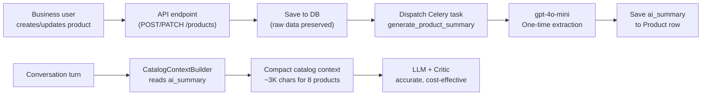

# Design: Ingestion-Time Product Summarization

## Problem

Business users upload raw, verbose product data — full spec sheets, usage guides, ingredient lists, precautions, preparation instructions — into `custom_fields` and `description`. The system currently dumps all of this raw content into every LLM call, causing:

- **40K+ char catalog contexts** (~10K tokens) per conversation turn
- LLM confusion: fails to locate products (denies a known product exists)
- Critic inconsistency: approves then rejects the same recommendation
- Unnecessary token cost across every conversation

The user should not be expected to optimize their data. The system must handle it.

---

## Solution Overview



**Principle:** Raw data is preserved as-is. A background task distills it once into a structured `ai_summary`. All downstream AI consumers read the summary, not the raw data.

---

## 1. Schema Change

Add one column to the `products` table:

```python
# In app/models/trade/catalog.py -> Product
ai_summary = Column(Text, nullable=True)
```

| Field | Type | Purpose |
|-------|------|---------|
| `ai_summary` | `Text, nullable` | LLM-generated structured digest of the product's key attributes, applications, and differentiators |

**Migration:** Standard Alembic `add_column`. Nullable so existing products work until backfilled.

---

## 2. Celery Task: `generate_product_summary`

**File:** `app/tasks/knowledge.py` (existing task file, already autodiscovered)

### Trigger Points

| Event | Where | How |
|-------|-------|-----|
| Product created | products.py L220-224 | After `db.commit()`, dispatch `generate_product_summary.delay(product.id)` |
| Product updated | products.py L272-277 | After `db.commit()`, dispatch only if `description` or `custom_fields` changed |
| Backfill (one-time) | Management script | Iterate all products where `ai_summary IS NULL` |

### Task Logic

```
1. Load Product + Category from DB
2. Assemble raw text: name + brand + description + custom_fields (all of it)
3. Call gpt-4o-mini with extraction prompt (see section 3)
4. Save result to product.ai_summary
5. Log success/failure
```

### Guardrails
- **Idempotent:** Safe to re-run. Overwrites previous summary.
- **Failure-safe:** If LLM call fails, `ai_summary` stays `NULL`. The `CatalogContextBuilder` falls back to raw data (current behavior, no regression).
- **Rate-limited:** Process sequentially within Celery worker (concurrency=1, already configured).
- **Token cap:** Input capped at 6,000 tokens to prevent runaway costs on extremely large technical sheets.

---

## 3. Extraction Prompt

The prompt extracts a **structured, fixed-format summary** — not free-form text. This ensures consistency across products and makes the downstream catalog context predictable.

```
Eres un asistente de catalogación de productos comerciales.
Tu trabajo es resumir la información de cualquier tipo de producto
en un formato estructurado y consistente.
NO inventes información que no esté en los datos.
Si un campo no tiene información, escribe "No especificado".

Producto: {name}
Marca: {brand}
Categoría: {category_name}

DATOS DEL PRODUCTO:
{description}
{custom_fields_text}

EXTRAE:
1. USOS PRINCIPALES: Lista breve de para qué sirve el producto (máx 3 líneas)
2. CARACTERÍSTICAS CLAVE: Atributos distintivos del producto (máx 3)
3. TIPO DE PRODUCTO: Clasificación dentro de su categoría
4. PRESENTACIÓN: Formato, tamaño o contenido (ej: Botella 500ml, Bolsa 1kg, Caja 12 piezas)
5. RENDIMIENTO/DURACIÓN: Cobertura, duración o porciones por unidad (si está disponible)
6. VENTAJAS CLAVE: Máximo 3 beneficios diferenciados

Responde SOLO con los 6 campos, sin explicaciones adicionales.
```

### Expected Output (~200-300 chars per product)

**Example A — Construction material:**
```
1. USOS PRINCIPALES: Adhesión y recubrimiento de láminas de poliestireno,
   paneles de yeso, molduras arquitectónicas.
2. CARACTERÍSTICAS CLAVE: Base cementicia; aplicación en pasta; interior/exterior.
3. TIPO DE PRODUCTO: Adhesivo cementicio en polvo.
4. PRESENTACIÓN: Saco de 20 kg.
5. RENDIMIENTO/DURACIÓN: 3.5 a 4.5 m² por saco.
6. VENTAJAS CLAVE: Alta adherencia; previene eflorescencias; fácil preparación.
```

**Example B — Pet food:**
```
1. USOS PRINCIPALES: Alimentación diaria de perros adultos razas medianas
   y grandes.
2. CARACTERÍSTICAS CLAVE: Fórmula con proteína de pollo; sin colorantes
   artificiales; enriquecido con omega 3 y 6.
3. TIPO DE PRODUCTO: Alimento seco para perro adulto.
4. PRESENTACIÓN: Bolsa de 15 kg.
5. RENDIMIENTO/DURACIÓN: Aprox. 45 días para perro de 20 kg.
6. VENTAJAS CLAVE: Pelaje brillante; digestión saludable; alta palatabilidad.
```

**Example C — Hair salon product:**
```
1. USOS PRINCIPALES: Coloración permanente del cabello; cobertura de canas;
   cambio de tono.
2. CARACTERÍSTICAS CLAVE: Tecnología de micropigmentos; sin amoníaco;
   con aceite de argán.
3. TIPO DE PRODUCTO: Tinte permanente en crema.
4. PRESENTACIÓN: Tubo de 60 ml + revelador 90 ml.
5. RENDIMIENTO/DURACIÓN: 1 aplicación cabello medio; duración 6-8 semanas.
6. VENTAJAS CLAVE: Cobertura total de canas; no reseca; color vibrante.
```

---

## 4. CatalogContextBuilder Integration

**File:** `app/services/catalog_context.py`

### Change to `format_product_line`

```python
def format_product_line(product: Product, allow_price_disclosure: bool = True) -> str:
    parts = [f"**{product.name}**"]

    if product.brand:
        parts.append(f"Marca: {product.brand}")
    if product.category and hasattr(product.category, "name"):
        parts.append(f"Categoria: {product.category.name}")
    if product.unit_of_measure:
        parts.append(f"Unidad: {product.unit_of_measure}")
    if product.wholesale_threshold is not None:
        parts.append(f"Umbral Mayorista: {product.wholesale_threshold}")

    if allow_price_disclosure and product.price is not None and product.price > 0:
        parts.append(f"Precio: ${product.price:.2f}")

    # NEW: Use ai_summary if available, else fall back to raw data
    if product.ai_summary:
        parts.append(product.ai_summary)
    else:
        # Current behavior (fallback for un-summarized products)
        if product.custom_fields and isinstance(product.custom_fields, dict):
            # ... existing custom_fields logic ...
        if product.description:
            clean_desc = product.description.strip().replace("\n", " ")
            if len(clean_desc) > 800:
                clean_desc = clean_desc[:797] + "..."
            parts.append(f"Descripcion: {clean_desc}")

    return "- " + " | ".join(parts)
```

### Impact on Context Size

| Scenario | Current | With `ai_summary` |
|----------|---------|-------------------|
| 8 products (sample client) | ~40,000 chars | ~3,000 chars |
| 15 products | ~75,000 chars | ~5,500 chars |
| 50 products (pruned to 10) | ~50,000 chars | ~3,500 chars |

---

## 5. Critic Integration

With compact catalog context, the Critic receives ~3K instead of ~40K chars. Two options:

### Option A: Keep Critic As-Is (Conservative)
The Critic automatically benefits because `product_list_str` (passed at `prospect_qualifier.py` L1105) is now compact. No code change needed in `technical_critic.py`.

### Option B: Remove Critic (Aggressive, evaluate after testing)
If the compact catalog proves reliable enough for `gpt-4o-mini` to ground correctly, the Critic can be removed — saving one LLM call per recommendation turn. **Decision deferred to post-implementation testing.**

**Recommendation:** Ship with Option A first. Measure Critic rejection rate over 1-2 weeks. If false rejections drop to near-zero, switch to Option B.

---

## 6. Cost Analysis

### One-Time Summarization Cost
| Item | Value |
|------|-------|
| Model | `gpt-4o-mini` |
| Input per product | ~2,000 tokens (raw data, capped at 6K) |
| Output per product | ~150 tokens (structured summary) |
| Cost per product | ~$0.0004 |
| Sample client (8 products) | ~$0.003 |
| 100 products business | ~$0.04 |

### Per-Conversation Savings
| Item | Current | With Summary |
|------|---------|-------------|
| Catalog tokens per turn (8 products) | ~10,000 | ~800 |
| 5-turn conversation | ~50,000 tokens | ~4,000 tokens |
| Token savings | -- | **~92%** |
| Critic becomes reliable | No | Yes, potential removal (additional 50% savings) |

---

## 7. Backfill Strategy

For existing products with `ai_summary = NULL`:

```python
# One-time management command or Celery task
async def backfill_product_summaries(business_id: str = None):
    """Generate ai_summary for all products missing one."""
    query = select(Product).where(Product.ai_summary.is_(None))
    if business_id:
        query = query.join(Category).where(Category.business_id == business_id)

    products = (await db.execute(query)).scalars().all()
    for product in products:
        generate_product_summary.delay(product.id)
```

This can be triggered per-business from an admin endpoint or run globally as a one-time migration task.

---

## 8. Edge Cases

| Case | Handling |
|------|----------|
| Product has no description AND no custom_fields | `ai_summary` = name + category only. Minimal but functional. |
| LLM summarization fails (timeout, API error) | `ai_summary` stays `NULL`. Fallback to raw data. No regression. |
| User updates product data | Re-trigger summarization task. New summary overwrites old. |
| User updates only price (no content change) | Don't re-trigger. Check if `description` or `custom_fields` actually changed. |
| Very large custom_fields (>20K chars) | Cap input to extraction prompt at 6K tokens. Include product name + first 6K of content. |

---

## 9. Files Changed

| File | Change |
|------|--------|
| `app/models/trade/catalog.py` | Add `ai_summary = Column(Text, nullable=True)` |
| `migrations/versions/xxx_add_ai_summary.py` | Alembic migration |
| `app/tasks/knowledge.py` | Add `generate_product_summary` task |
| `app/api/trade/products.py` | Dispatch task after create/update |
| `app/services/catalog_context.py` | Use `ai_summary` in `format_product_line` |
| `app/core/celery_app.py` | No change (task file already autodiscovered) |
| `app/services/technical_critic.py` | No change (benefits automatically) |
